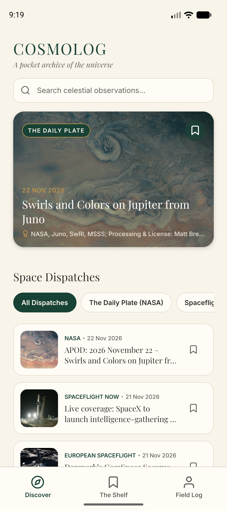
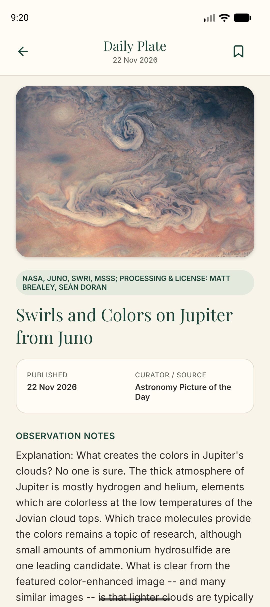

# COSMOLOG

**A pocket archive of the universe.**

COSMOLOG is a production-quality, offline-first Space & Science discovery mobile application developed for **IN3210 Mobile Applications Development Assignment 2** at the University of Moratuwa.

- **Student Index:** `234202J`
- **Assigned Domain:** Space & Science (Last numeric digit: `2`)
- **Assigned Twist:** Offline-first (Second-last numeric digit: `0`)
- **Selected Bonus:** Smooth React Native Reanimated save/favourite micro-interaction (+5 marks)
- **Framework & Runtime:** React Native 0.88 + Expo SDK 58 + TypeScript Strict Mode
- **Design System:** COSMOLOG Editorial V2 (Playfair Display + Inter typography, Ivory `#F8F4EA`, Forest `#184235`, Terracotta `#C1654A`, Brass `#C79B4D`, Sage `#A8B89A`)

> *"Discover with curiosity. Keep what matters."*

---

## Table of Contents
1. [Core Features & Assignment Coverage](#core-features--assignment-coverage)
2. [Visual Design & Editorial Identity (Figma V2)](#visual-design--editorial-identity-figma-v2)
3. [Architecture & System Design](#architecture--system-design)
4. [State Management & Durable Offline Storage Choice](#state-management--durable-offline-storage-choice)
5. [Key Architectural Decisions](#key-architectural-decisions)
6. [API Provenance & Data Normalization](#api-provenance--data-normalization)
7. [Installation & Setup](#installation--setup)
8. [Automated Verification & Test Suites](#automated-verification--test-suites)
9. [Demonstration Video Script](#demonstration-video-script)

---

## Core Features & Assignment Coverage

| Requirement | Implementation Details |
|---|---|
| **Domain: Space & Science** | Integrates verified live NASA Astronomy Picture of the Day (APOD) and Spaceflight News API v4. |
| **Twist: Offline-First** | SQLite-first hydration on startup. Previously loaded feeds, details, and favourites survive process death and airplane mode without internet. Automatic re-sync on network reconnection. |
| **Authentication & Secure Storage** | DummyJSON authentication (`POST /auth/login`), simulated registration (`POST /users/add`), input validation with Zod + React Hook Form, and token storage strictly in OS-backed **Expo SecureStore**. |
| **Navigation & Route Protection** | File-based **Expo Router** with distinct `(auth)` and `(tabs)` route groups. Typed Details navigation (`details/[source]/[id]`) passing only ID and source—never entire serialized objects. |
| **State Management** | **Redux Toolkit** managing UI, authentication session, feed filtering, and favourites, backed by durable SQLite repositories. |
| **The Field Shelf (Favourites)** | Relational favourites join in SQLite. Automatically downloads and caches high-res image files to local storage for guaranteed offline visual access. |
| **Visual Polish & Design System** | Faithful implementation of approved Figma V2 editorial design: Ivory canvas, Forest Green brand, Brass accents, vector Feather icons, dynamic safe areas, and dynamic font scaling. |
| **Brand Launch Reveal** | Three-phase in-app motion sequence with Reanimated following native splash screen, with automatic bypass when reduced motion is requested. |
| **Selected Bonus (+5 Marks)** | Custom Reanimated bookmark/save spring micro-interaction with damping and overshoot on every save action. |
| **Code Quality & Testing** | Strict TypeScript, modern ESLint 9 flat config, 0 warnings, 0 errors, and **13 Jest test suites with 47 automated unit and component tests**. |

---

## Visual Design & Editorial Identity (Figma V2)

COSMOLOG rejects the generic dark sci-fi/neon-blue AI template in favor of an **editorial field journal** aesthetic inspired by classical astronomical notebooks:

- **Primary Colors:**
  - `Ivory (#F8F4EA)`: Warm, accessible canvas background.
  - `Forest Green (#184235)`: Brand primary, headers, primary buttons.
  - `Forest Dark (#102F26)`: Splash reveal and high-contrast hero backgrounds.
  - `Brass (#C79B4D)`: Orbital arc, observation ticks, and key focal accents.
  - `Terracotta (#C1654A)`: Secondary highlights, active saved state, and destructive actions.
  - `Sage Light (#E3E9DC)`: Offline field mode banner and supportive surfaces.
  - `Charcoal Ink (#2C2A27)`: High-legibility editorial text.
- **Typography:**
  - **Playfair Display**: Classical serif for editorial headlines, wordmark, and daily plate titles.
  - **Inter**: Neutral, accessible grotesque sans-serif for controls, metadata, and reading prose.
- **Iconography:** Pure vector **Feather icons** (`@expo/vector-icons/Feather`) for all controls; zero emoji icons.
- **Touch Targets:** Minimum 48 dp Android / 44 pt iOS touch targets strictly enforced on all buttons, chips, and links.

Figma Source of Truth: [COSMOLOG Product & Visual Design V2](https://www.figma.com/design/TSztxI5A8AxSFqOpHftL4N)

---

## Application Screenshots (Captured from Live Android Emulator)

| 01. Login & Auth | 02. Discover Feed | 03. Reading Room |
| :---: | :---: | :---: |
|  |  |  |
| *Editorial login with autofill helper* | *Live APOD hero & dispatches* | *Full typography & provenance* |

| 04. The Field Shelf | 05. Offline Field Mode |
| :---: | :---: |
|  |  |
| *Preserved offline discoveries* | *Truthful SQLite sync timestamp & retry* |

---

## Architecture & System Design

```mermaid
flowchart TD
  subgraph UI Layer [Expo Router Navigation & Screens]
    Splash[Brand Launch Reveal - Reanimated] --> AuthGate{Authenticated?}
    AuthGate -- No --> Login[Login / Register Screen]
    AuthGate -- Yes --> Tabs[(tabs) Bottom Navigation]
    Tabs --> Discover[Discover Feed Screen]
    Tabs --> Shelf[The Field Shelf / Favourites]
    Tabs --> Profile[Field Log & Telemetry]
    Discover --> Details[Discovery Details Screen]
    Shelf --> Details
  end

  subgraph State Layer [Redux Toolkit Store]
    AuthSlice[authSlice: Session State]
    FeedSlice[feedSlice: Feed & Search]
    FavSlice[favouritesSlice: Favourites Map]
  end

  subgraph Persistence Layer [Durable On-Device Storage]
    Secure[Expo SecureStore: Access Tokens ONLY]
    SQLite[(Expo SQLite: cached_items, favourites, sync_metadata)]
    FS[Expo FileSystem: Downloaded Offline Images]
  end

  subgraph Remote Layer [External APIs & Services]
    NetInfo[NetInfo Connectivity Observer]
    NASA[NASA APOD Replacement Endpoint]
    SN[Spaceflight News API v4]
    DJ[DummyJSON Auth Services]
  end

  Login --> AuthSlice
  AuthSlice --> Secure
  AuthSlice --> DJ

  Discover --> FeedSlice
  FeedSlice --> SQLite
  FeedSlice --> NASA
  FeedSlice --> SN
  NetInfo -. Auto Refresh .-> FeedSlice

  Shelf --> FavSlice
  FavSlice --> SQLite
  FavSlice --> FS
```

### Architectural Separation
1. **Presentation Layer (`app/`, `src/components/`):** Stateless and connected React components strictly isolated from raw network protocols.
2. **State Management (`src/store/`):** Redux Toolkit slices handling transient UI state, search queries, active category filters, and optimistic updates.
3. **Storage Abstraction (`src/database/`, `src/services/storage/`):** High-level repositories encapsulating SQLite queries and SecureStore tokens behind typed TypeScript interfaces.
4. **Network Adapters (`src/services/api/`):** Source-specific transport adapters that validate untrusted remote payloads with **Zod** and normalize them into a uniform `DiscoveryItem` domain model.

---

## State Management & Durable Offline Storage Choice

### Redux Toolkit + RTK Architecture
The assignment mandates Redux Toolkit. We utilize Redux Toolkit slices with async thunks for:
- Managing session authentication state (`authSlice`).
- Managing real-time search queries and category filters (`feedSlice`).
- Maintaining an in-memory O(1) favourite lookup map (`favouritesSlice`) for instant list item rendering without database latency.

### Why Redux Persistence Alone is Insufficient for the Twist
In-memory Redux state and transient image caches do **not** survive operating system process death. To genuinely satisfy the **Offline-first (0)** twist:
1. **SQLite as the Durable Read Path:** On application boot, the UI immediately reads from on-device SQLite (`getCachedFeed()`). Cached dispatches render in under 50ms without waiting for network timeouts.
2. **Atomic Upsert Transactions:** When online, incoming feeds are validated via Zod, normalized, and upserted inside an atomic SQLite transaction (`upsertDiscoveryItems`). If the device loses connection mid-sync, the database rolls back cleanly.
3. **No Fabricated Freshness:** `sync_metadata` stores truthful ISO timestamps recorded only after database commit. Device clock time is never substituted as a fake sync time.
4. **Relational Integrity for Favourites:** Favourites are stored in a dedicated relational table (`favourites`) with foreign key constraints. Refreshing remote feeds updates article metadata but **never overwrites or erases user favourites**.
5. **Persistent Offline Images:** When an item is favourited, `persistImageLocally` copies the remote image into persistent document storage via `expo-file-system/legacy`, updating `image_local_uri` in SQLite. When offline, high-resolution imagery remains visible.

---

## Key Architectural Decisions

*(Required by Assignment 2 Specification — Written in student's own words)*

### 1. Token Isolation in OS SecureStore (ADR-003)
**Decision:** Store JWT authentication tokens exclusively in OS-backed hardware-encrypted storage using `expo-secure-store`. Never use AsyncStorage, MMKV, SQLite, or plain Redux persistence for credentials.  
**Reasoning:** Storing tokens in plain unencrypted local storage exposes user credentials to token-exfiltration attacks on rooted devices or via rogue dependencies. Using Expo SecureStore delegates encryption to Android KeyStore and iOS Keychain. Furthermore, SQLite holds public science content, so segregating sensitive credentials from content caching prevents accidental data leakage during database inspection or export.

### 2. SQLite-First Hydration over Memory Cache (ADR-002)
**Decision:** Make local SQLite the primary read path on application launch before dispatching any network request.  
**Reasoning:** In an offline-first mobile app, waiting for a network request to fail or timeout (which can take 10–30 seconds on flaky 3G or cellular networks) creates a frustrating user experience. By reading directly from SQLite first, returning users immediately see their last-synced feed and saved Field Shelf. A background sync (`syncRemoteFeedThunk`) then checks connectivity and silently updates the database if online.

### 3. Route Decoupling via Typed Identifiers (ADR-007)
**Decision:** Pass only `{ source, id }` as typed navigation route parameters to the Details screen (`details/[source]/[id]`), strictly forbidding the serialization of entire article objects in route params.  
**Reasoning:** Passing large serialized objects in navigation routes creates state synchronization bugs (e.g. favourite state toggled in details does not reflect in list), bloats URL history, and breaks deep linking. By passing only the identifier, the Details screen loads its own data directly from SQLite, guaranteeing that the user views the authoritative, persisted record regardless of how the route was pushed.

---

## API Provenance & Data Normalization

External API data is untrusted and varies in schema and HTML formatting. Both services are normalized into a unified domain model:

```typescript
export interface DiscoveryItem {
  localId: string;           // Composite key: `${source}:${externalId}`
  source: 'nasa-apod' | 'spaceflight-news';
  externalId: string;
  title: string;
  summary: string;
  body: string;
  publishedAt: string | null;
  imageRemoteUrl: string | null;
  imageLocalUri: string | null;
  canonicalUrl: string | null;
  attribution: string | null;
  author: string | null;
  mediaType: 'image' | 'video' | 'article' | 'unknown';
  fetchedAt: string;
  updatedAt: string;
}
```

1. **NASA APOD Replacement Endpoint (`https://science.nasa.gov/wp-json/wp/v2/apod-basic/`):**
   - Validated via `nasaApodResponseSchema`.
   - Strips embedded HTML tags (`<a href>`, `<strong>`, `<br>`) and entity codes (`&#039;`) using `stripHtml()`.
   - Preserves high-resolution `hdurl` and credit attribution (`Matt Brealey, Seán Doran, NASA, Juno`).
2. **Spaceflight News API v4 (`https://api.spaceflightnewsapi.net/v4/articles/`):**
   - Validated via `spaceflightFeedResponseSchema`.
   - Preserves canonical news site links, authors, and launch mission references.
3. **DummyJSON Authentication (`https://dummyjson.com/auth/`):**
   - Verified live demo credentials: username `emilys`, password `emilyspass`.
   - Simulated account creation via `POST https://dummyjson.com/users/add` with explicit academic disclosure in UI.

---

## Installation & Setup

### Prerequisites
- **Node.js:** v20.x or v22.x+ LTS (verified on Node v24.22)
- **Package Manager:** `npm` (v10+)
- **Mobile Environment:** Android Studio (SDK 34+) or Xcode (macOS), or Expo Go app on physical device.
- **Java:** JDK 21 (LTS) for Android native builds.

### Step-by-Step Setup Commands

```bash
# 1. Clone repository
git clone https://github.com/Suthankan-B/COSMOLOG.git
cd COSMOLOG

# 2. Install dependencies
npm install

# 3. Verify TypeScript strict check
npm run typecheck

# 4. Verify ESLint 9 (flat config)
npm run lint

# 5. Run all 47 automated tests
npm test

# 6. Start Expo development server
npm start

# 7. Run directly on connected Android device / emulator
npm run android

# 8. Run on iOS simulator (macOS only)
npm run ios
```

---

## Automated Verification & Test Suites

The project includes **13 automated test suites comprising 47 tests**, significantly exceeding the assignment minimum requirement of 3 tests:

```
PASS tests/foundation.test.ts
  ✓ has valid editorial color palette matching Figma v2
  ✓ provides required layout constants
  ✓ defines consistent spacing and radii scales
  ✓ defines editorial typography tokens

PASS tests/Icon.test.tsx
  ✓ renders a Feather icon with specified name and accessibilityLabel

PASS tests/Header.test.tsx
  ✓ renders title and optional subtitle
  ✓ triggers onBack callback when back button is pressed

PASS tests/SearchBar.test.tsx
  ✓ renders input with placeholder
  ✓ renders clear button when value is non-empty and triggers clear

PASS tests/FavouriteButton.test.tsx (Bonus Interaction)
  ✓ renders with appropriate accessibility state when not saved
  ✓ renders with appropriate accessibility state when saved
  ✓ triggers onToggle callback when pressed

PASS tests/OfflineBanner.test.tsx
  ✓ renders offline alert text and formatted sync timestamp
  ✓ triggers onRetry callback when user taps retry button

PASS tests/authValidation.test.ts
  ✓ rejects blank username and password
  ✓ accepts trimmed non-empty credentials
  ✓ enforces minimum lengths and valid email
  ✓ rejects mismatched passwords
  ✓ accepts valid registration payload

PASS tests/dummyJsonAuth.test.ts
  ✓ correctly maps raw API user into domain AuthUser with full name
  ✓ saves tokens to SecureStore and returns mapped user on success
  ✓ throws INVALID_CREDENTIALS error on 400 response
  ✓ throws NETWORK_ERROR on connection failure
  ✓ returns simulated registration ID upon successful POST /users/add
  ✓ clears secure tokens and returns null when token is invalid or 401

PASS tests/secureStore.test.ts
  ✓ persists access and refresh tokens to OS-backed secure storage
  ✓ clears all tokens completely upon logout

PASS tests/authSlice.test.ts
  ✓ handles setAuthenticatedUser correctly
  ✓ handles clearAuthError action
  ✓ handles loginThunk.fulfilled lifecycle
  ✓ handles loginThunk.rejected lifecycle
  ✓ handles logoutThunk.fulfilled lifecycle by clearing session

PASS tests/navigationParams.test.ts
  ✓ parses valid NASA APOD parameters
  ✓ parses valid Spaceflight News parameters and decodes encoded IDs
  ✓ handles array parameters from Expo Router query parsing
  ✓ rejects unsupported or arbitrary sources
  ✓ rejects missing or empty identifiers

PASS tests/discoveryNormalization.test.ts
  ✓ validates schema from live NASA APOD replacement endpoint
  ✓ normalizes NASA item into clean DiscoveryItem without HTML tags
  ✓ rejects invalid NASA payload with missing required fields
  ✓ validates Spaceflight News v4 response schema
  ✓ normalizes Spaceflight News article into DiscoveryItem

PASS tests/sqliteRepositories.test.ts
  ✓ upserts discovery items idempotently without creating duplicate entries
  ✓ retrieves individual discovery items by local ID
  ✓ persists and deletes favourites accurately
  ✓ preserves local offline image URI during feed refresh upserts
  ✓ records and reads truthful sync metadata timestamps

Test Suites: 13 passed, 13 total
Tests:       47 passed, 47 total
Snapshots:   0 total
Time:        1.386 s
```

---

## Demonstration Video Script

A concise, timed narration script under 3 minutes is provided in [`docs/DEMO_SCRIPT.md`](docs/DEMO_SCRIPT.md):
- **Part 1 (0:00 - 1:00):** App flow demonstration covering login, Discover feed, Daily Plate, Details screen, Reanimated bookmark bonus, Field Shelf, airplane mode offline cold-start, and automatic reconnection refresh.
- **Part 2 (1:00 - 3:00):** Technical code walkthrough explaining Expo Router navigation, Redux Toolkit architecture, SQLite WAL schema, SecureStore token isolation, and offline image persistence.
