# COSMOLOG

COSMOLOG is an editorial space and science archive for IN3210 Assignment 2. Read NASA Astronomy Picture of the Day and Spaceflight News dispatches, save discoveries to the Field Shelf, and leave private notes for later. A previously verified account can reopen the archive in airplane mode.

**Assignment mapping** · Index 234202J · Space & Science (2) · Offline-first (0)

**Selected bonus** · Reanimated bookmark feedback on a confirmed save, with reduced-motion support

## Run locally

Use the Node version in [`.nvmrc`](.nvmrc), a JDK 21 installation and Android Studio with the SDK/NDK required by the checked-in Android project. For iOS, install a compatible full Xcode and its simulators.

```sh
nvm use
npm ci
npm run android
```

For iOS use `npm run ios`. No API key or `.env` is required. Tap **Use demo account** on the sign-in screen. Registration exercises the DummyJSON simulation and returns to sign-in. The public demo account signs in independently.

### Self-contained Android build

A Gradle release build embeds the JavaScript bundle and assets. For an installable build, supply the local keystore path and its credentials using `COSMOLOG_SIGNING_STORE`, `COSMOLOG_SIGNING_STORE_PASSWORD`, `COSMOLOG_SIGNING_KEY_ALIAS`, and `COSMOLOG_SIGNING_KEY_PASSWORD`. Keep signing secrets outside the repository. With the Android SDK and JDK configured, run:

```sh
cd android
./gradlew :app:assembleRelease
```

Use the existing debug key only for local QA. Avoid Metro when validating airplane-mode cold starts.

## Offline walkthrough

1. Sign in online and wait for the two sources to populate Discover.
2. Open a discovery and save it. Text and provenance are available immediately. For a licensed image, wait for **Image available offline** before relying on the file.
3. Add a note in Details. Open Favourites to find the record by its title, publisher, or note. Use the **With notes** and **Image downloaded** filters.
4. Force-stop the app, turn on airplane mode, then launch it. Open Discover and the saved discovery, including any downloaded image. Edit the note and reopen the record.
5. Restore connectivity. Discover refreshes automatically. Profile shows the last successful timestamp for each source.

A fresh install needs connectivity for the first sign-in. A returning user with a verified SecureStore session can read locally during a network or account service outage. A legacy token-only install needs one verification online. If earlier device bookmarks exist, the Shelf offers a one-time import to the current account.

### Smart Reading

Scroll into a story to save a reading position. **Continue Reading** on Discover reopens the most recent unfinished story at its saved paragraph. **Dismiss** clears the checkpoint. **Mark as read** also adds the story to the account's offline **Reading history** on the Field Shelf. Use **To read** to filter out completed favourites. Changing the source text starts the reader at the top; changing text size preserves the paragraph anchor.

**Search space materials** checks SQLite immediately. With an internet connection, enter at least two characters to search the Spaceflight News and NASA media archives. Device results appear first. Scroll or tap **Load more results** for more matches. Select **NASA Media** for images, video and audio. **Search the wider web** opens a topic search in your browser. The Field Shelf searches private notes.

### Voice-to-Text: Voice Search & Observation Dictation
- **Hands-Free Celestial Search:** Tap the vector Feather `mic` button in the Search Bar to speak queries (*"Jupiter"*, *"James Webb"*, *"SpaceX"*). Spoken words stream live into the search input with real-time SQLite filtering and astronomical term biasing.
- **Voice Field Notes:** When viewing a saved discovery in the reading room, open **Add a note** or **Edit note** and tap **Dictate observation**. Real-time speech transcribes directly into the private field note editor with multi-sentence concatenation, live character limits (`draft.length / 1000`), and durable SQLite persistence.
- **Offline On-Device Recognition:** Utilizes hardware-accelerated on-device speech engines on supported devices (Android 13+ / iOS 17+) via `expo-speech-recognition`, allowing astronomers to search and dictate notes in remote dark-sky locations with zero internet connection.

Space Dispatches load in pages of 15. Older pages stay on the device through refreshes and restarts. **Reopen search** restores the latest stored search for the selected edition. Saved NASA media records preserve their description, date, credit and source link. Open the original online for playback or the full-resolution asset.

[Online archive search](docs/screenshots/22-online-archive-search.png) · [Search after an offline restart](docs/screenshots/23-offline-archive-search.png)

**Browse by date** opens a NASA plate from SQLite or retrieves it online the first time it is needed. Opening an older plate does not change the latest feed snapshot.

Under **Study, sky and archives**, **On This Day** offers an earlier NASA plate from the same month and day. Discover checks the local archive first. If no match is stored, it offers an online lookup for the most recent eligible prior year.

On the Field Shelf, open **Shelf tools → Collections**, create a named collection, then tap **Choose discoveries** to group existing favourites. A discovery can belong to multiple collections. You can create, rename, edit, and browse collections offline. Deleting a collection keeps its favourites and field notes.

From Discover, open **Study, sky and archives → Offline reading packs** to download **A Tour of Saturn** or **Apollo at the Moon**. Each card shows which plates are stored and the status of images eligible for offline storage. If the connection drops, reopen the pack and resume the missing entries. Removing a download keeps any matching favourites, notes, and reading history.

### Sky Viewer

Open **Discover → Study, sky and archives → Sky Viewer** and tap **Use my location**. Hold the back of your phone toward the sky to orient the chart. To explore manually, drag the chart or use the arrow buttons. **Change location** accepts signed decimal coordinates and offers a Colombo preview. Tap a marker or choose an object in **Objects above the horizon** to read its details and follow its source links.

The bundled star and deep-sky catalogs, Moon and planet positions, and detail text work offline. The chart shows geometric positions. Your equipment, daylight, and observing conditions affect what you can see. When orbit data is available, the ISS and Hubble are shown as predictions. The viewer flags elements at 24 hours and hides predictions at 72 hours. Locations and motion readings stay in memory. [Catalog sources and licences](src/features/sky/catalog/README.md)

### Media and provenance

NASA APOD and Spaceflight News retain the original publication link, available credits, and source date. **Share discovery** opens the device share sheet with the public title, credit, and link. The sheet can open from cached Details while offline. News records contain publisher summaries. APOD video and iframe records link to the source. The app stores images durably when a recognized Creative Commons license or documented NASA-only credit permits it. Other records retain text and provenance. Each saved entry reports its actual image state. The sign-in masthead uses NASA’s Earthrise photograph, AS08-14-2383, credited to NASA / Bill Anders.

- [NASA APOD API](https://api.nasa.gov/assets/files/apod/APOD-APIs-and-RSS-info.pdf)
- [Spaceflight News API v4](https://api.spaceflightnewsapi.net/v4/docs/)
- [DummyJSON authentication](https://dummyjson.com/docs/auth)
- [NASA Earthrise](https://science.nasa.gov/resource/apollo-8s-iconic-earthrise/)
- [Jupiter image credits](https://science.nasa.gov/wp-json/wp/v2/apod-basic/261122) · NASA/Juno/SwRI/MSSS, processing by Matt Brealey and Seán Doran · [CC BY-NC 3.0](https://creativecommons.org/licenses/by-nc/3.0/)
- [Cocoon Nebula Wide Field](https://apod.nasa.gov/apod/ap140918.html) · Federico Pelliccia

## Magazine edition

COSMOLOG opens with a one-second reveal of the Apollo 17 globe and ivory masthead. Skip is available immediately. Reduce Motion goes directly to session handoff. The source selector stays above the cover as readers switch between All sources, Daily Plates and Dispatches. A missing network connection preserves access to the local archive.

The centred three-tab dock targets 264 points at standard type size and expands for larger labels. Supported iPhones use native glass, with an opaque Reduce Transparency fallback. Android uses an elevated ivory surface.

| All sources | Daily Plates | Dispatches |
| --- | --- | --- |
| 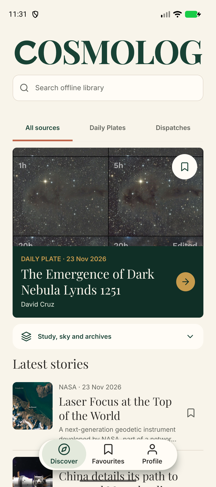 | 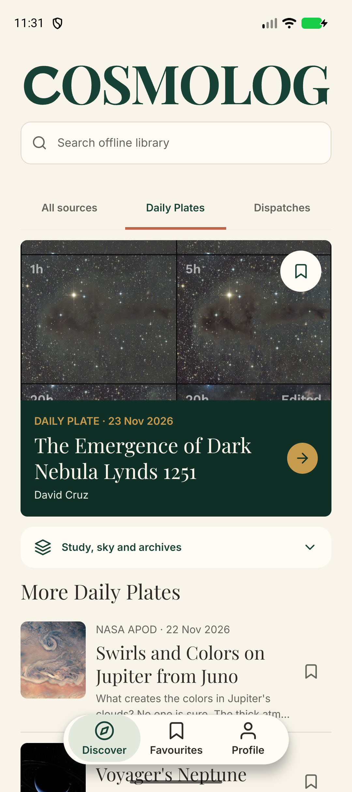 | 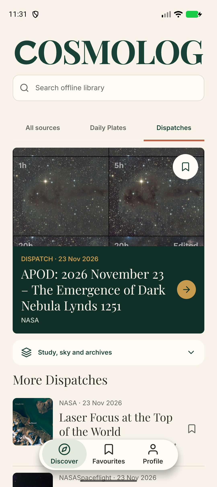 |

| Sign in | Article | Field Shelf | Cold launch offline |
| --- | --- | --- | --- |
| 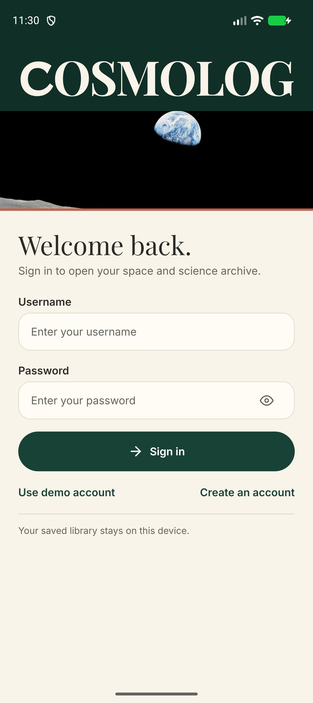 | 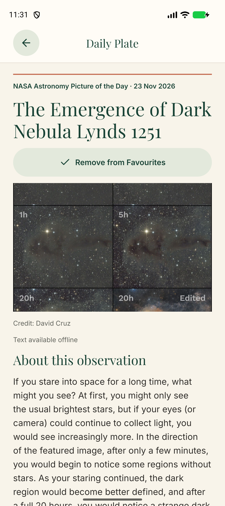 | 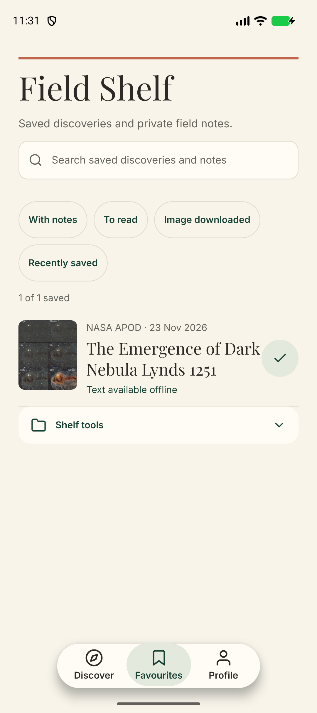 | 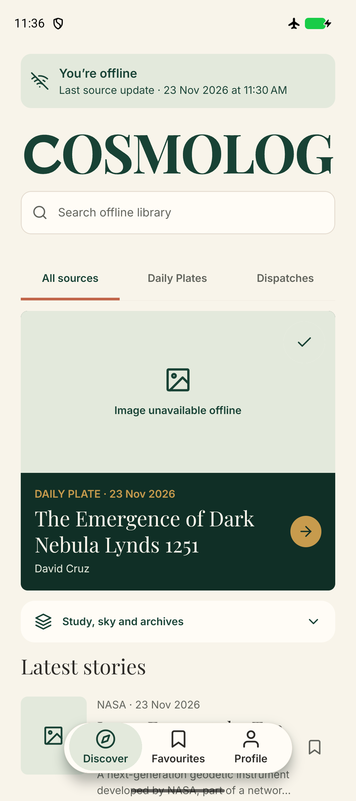 |

[Magazine identity and launch storyboard](design/magazine/identity-and-motion.svg) · [Editable edition layouts](design/magazine/editions.svg) · [Magazine screen handoff](design/magazine/screens.svg)

## Earlier release screenshots

| Sign in | Discover | Details |
| --- | --- | --- |
| 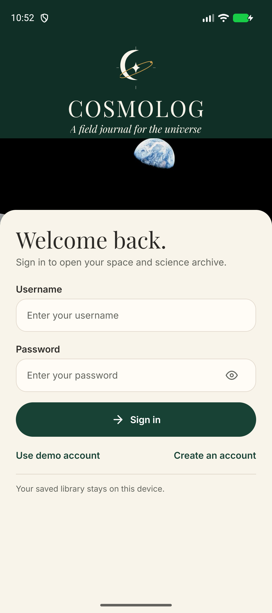 |  |  |

| Field Shelf | Cold launch offline | Offline field note |
| --- | --- | --- |
| 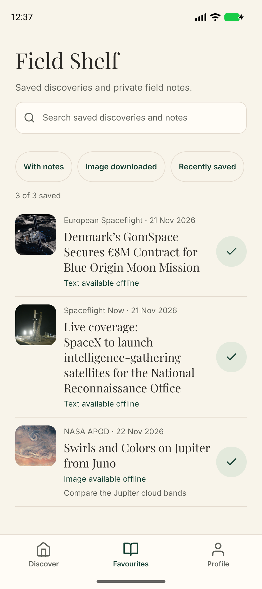 | 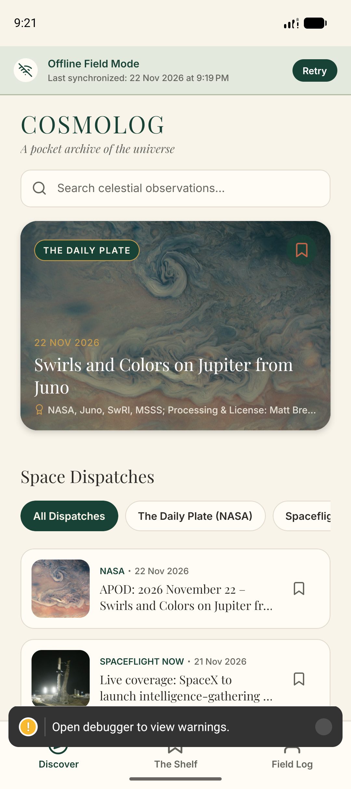 |  |

| Plate opened by date | Continue Reading | Offline archive search |
| --- | --- | --- |
| 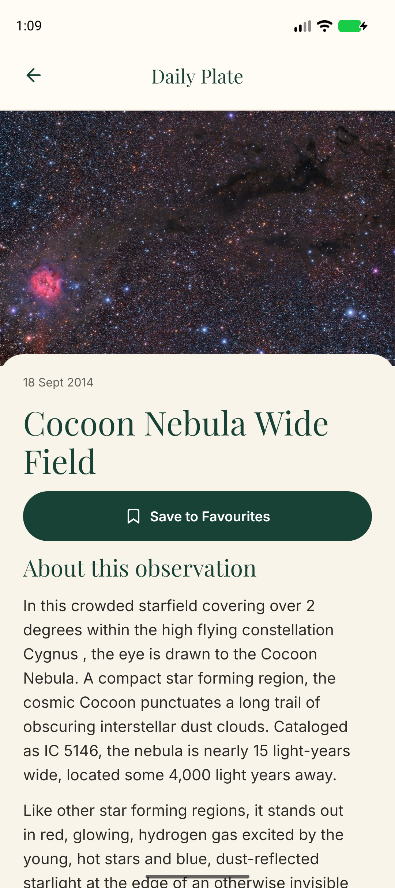 | 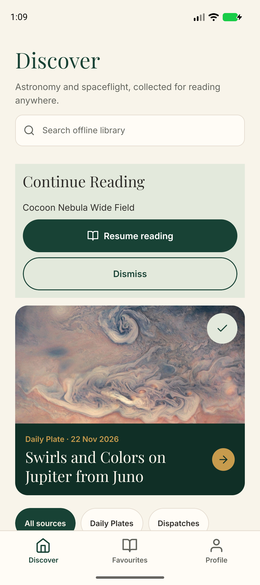 | 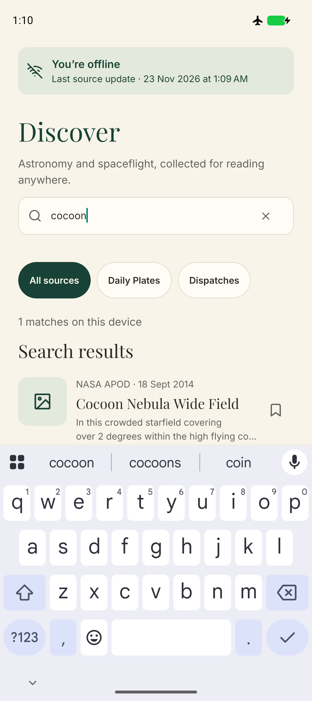 |

| Field Shelf collection in airplane mode | Reading pack in airplane mode |
| --- | --- |
| 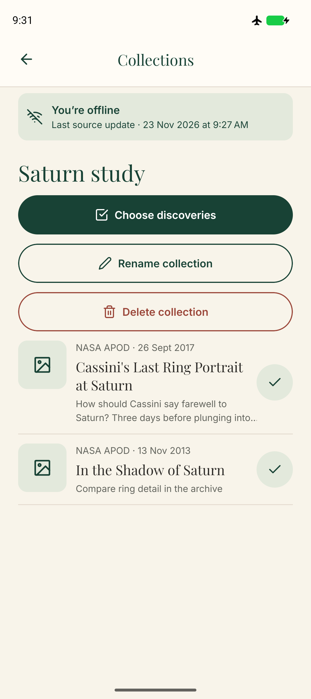 | 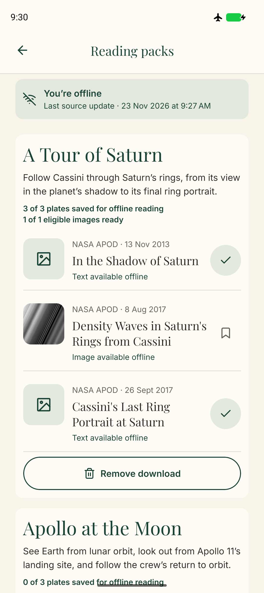 |

| Sky Viewer in airplane mode | Whirlpool Galaxy details in airplane mode |
| --- | --- |
| 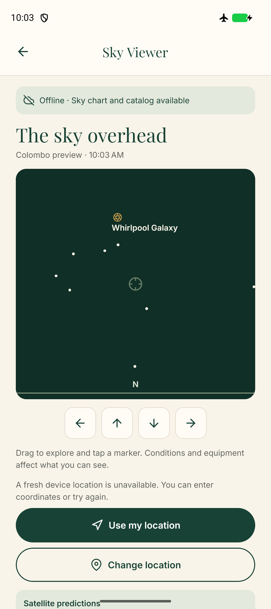 | 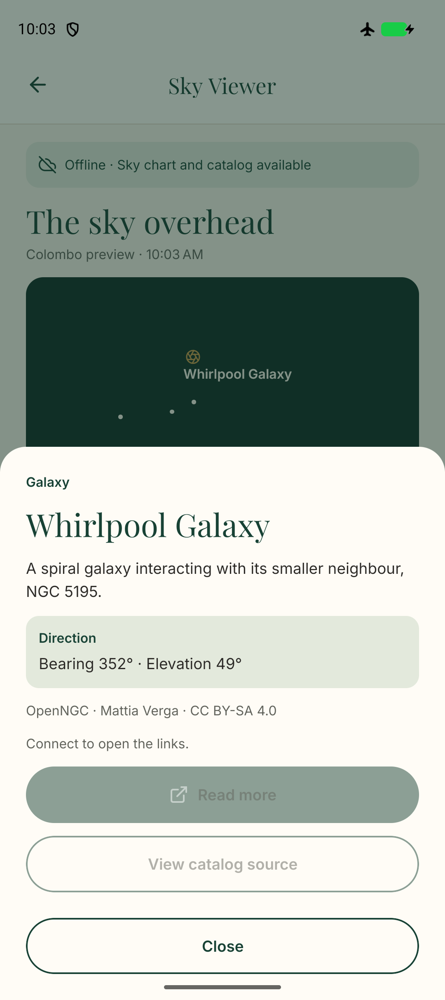 |

## Architecture and state

Expo Router protects the main stack and passes a source and ID to Details. A Redux Toolkit coordinator loads SQLite before starting remote refresh. It shares connection, request, and save state across the screens. Validated and normalized source responses become SQLite transactions. Each transaction updates a source snapshot and its last successful timestamp together.

Sky Viewer calculates celestial positions and device pointing locally. It uses the same Redux Toolkit thunk pattern for CelesTrak requests and stores the last validated orbital elements in SQLite. Viewer focus and connection state control requests, and the database enforces a two-hour minimum between attempts.

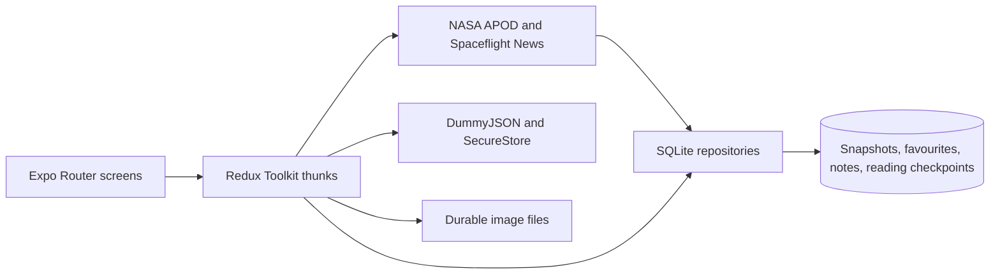

See [Architecture](design/ARCHITECTURE.md), [Data model](design/DATA_MODEL.md), and [Decision records](docs/DECISIONS.md).

### Key decisions

1. **Restore the verified session locally.** A network profile check made an offline restart look like a logout. SecureStore now holds the verified identity and tokens. Online validation can refresh or revoke them while the archive remains available during a temporary service failure.
2. **Use SQLite and one sync coordinator.** Cached items, source membership, and refresh metadata are durable together. Redux Toolkit thunks were retained so the app has one place that controls request ordering and reconciles results with SQLite. The trade-off is that the coordinator owns deduplication and retry behavior.
3. **Separate bookmarking from downloading.** A file server can be slow or down, so the bookmark is committed first. Image status becomes ready only after the validated local file exists. The journal has useful text and notes even when the image is unavailable.
4. **Keep online search separate from the feed.** Search records share the SQLite item table. Ordered search results belong to the account and edition. Looking up Europa never replaces the Daily Plate or advances the feed timestamp. NASA media search runs directly against its public catalogue. The wider-web action requires no hosted proxy or search API key. [NASA media API](https://images.nasa.gov/docs/images.nasa.gov_api_docs.pdf)
5. **Own bookmarks and notes by account.** Feed records are public, so the database can reuse them across accounts. The SQLite favourite relationship carries ownership and the field note. A legacy bookmark has no owner until a signed-in person imports it.

## Verification

```sh
npm run lint
npm run typecheck
npm test -- --runInBand
```

Jest exercises auth lifecycle, real SQLite migrations and rollback through Node's SQLite driver, reconnect and source failure behavior, route validation, media normalization, checkpoints, and archive search. A GitHub Actions workflow repeats the JavaScript checks on a clean install. The Smart Reading Android run verified paragraph restore and local search after an airplane-mode cold launch, date lookup, and automatic recovery for an uncached plate on reconnect. See [device scenarios and evidence](docs/TEST_PLAN.md), the [demo script](docs/DEMO_SCRIPT.md), and [AI usage](AI_USAGE.md).

## Space Study

Open **Discover → Study, sky and archives → Space Study** for eight original introductory chapters and the object atlas. Try **M31**, **25544**, **Titan** or **Starlink**. Chapters include definitions, examples and source links. Save a section to the Field Shelf, add a private field note or reopen the last chapter with **Continue reading**. The bundled guide and the Earthrise figure are available after an offline restart with a restored session.

**My sky → Change location** searches 52,004 places offline. Pick a city to use its coordinates and civil time zone. Selecting another location or the Colombo preview replaces the remembered city. Geometric altitude tells you where a target lies relative to the horizon. Weather and daylight still affect observation. The first edition includes STARLINK-1008 and STARLINK-1012 alongside ISS and Hubble. [GeoNames attribution](assets/study/README.md) · [CelesTrak Starlink catalog](https://celestrak.org/NORAD/elements/table.php?GROUP=starlink)

**Editions and downloads** includes an installable observatories supplement. New editions use versioned JSON parts and the manifest in study-releases. The app checks the project's public main-branch manifest when Downloads is active and online, at most once daily. Each part has an expected byte length, checksum and record count. SQLite activates the new edition after validation. Bookmarked entries survive removal. Publishing a new remote edition requires publishing the corresponding repository assets. The bundled first edition works independently.

The archive migration preserves existing discoveries, favourites and orbital data. Study routes carry a stable ID. Reader checkpoints and notes belong to the signed-in account. City lookup uses a separate bundled SQLite index so opening Discover does not import place records.

| Android guide | Offline chapter bookmark | Kandy sky in airplane mode | iOS reader |
| --- | --- | --- | --- |
| 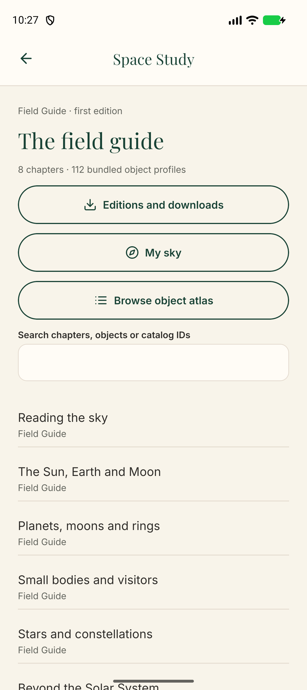 | 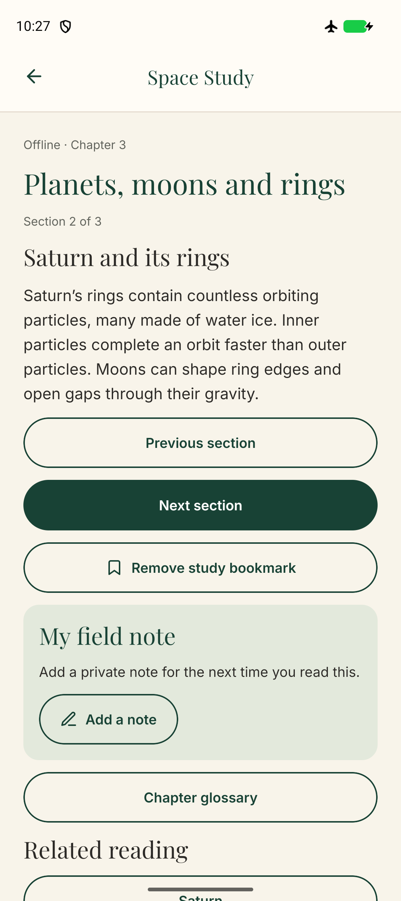 | 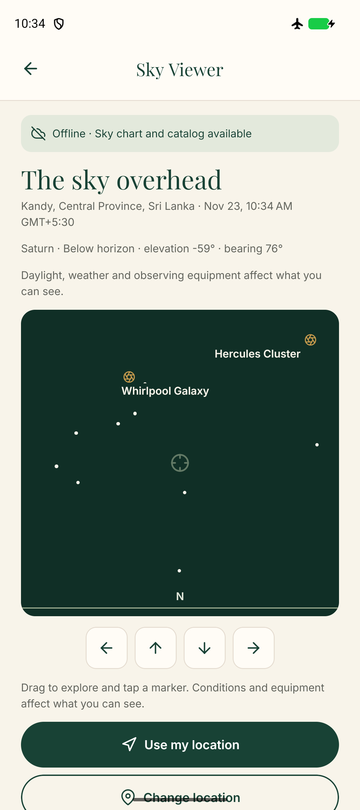 | 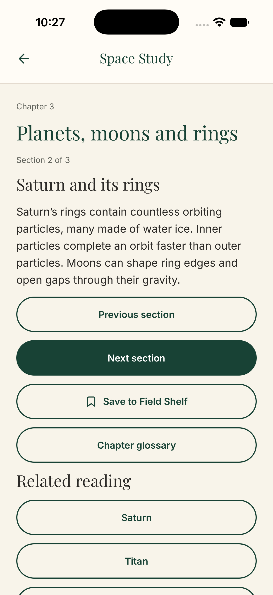 |

The first-edition city index occupies 11,960,320 bytes uncompressed and 5,279,873 bytes inside the Android APK. A Pixel 9 emulator timing harness ran 60 local searches against the installed SQLite edition using Hermes, including layout of the first result page. The 95th percentile was **22.8 ms**. Physical-device timing can differ. Before a content release, run `npm test -- --runInBand tests/studyEdition.test.ts tests/studyDownloads.test.ts` to validate the book and pack manifests.

## Planned cumulative expansion

The next releases extend the existing archive, Space Study, Sky Viewer and voice features into an offline-first field journal and exploration platform. See the [product roadmap](PRODUCT_ROADMAP.md), [feature catalogue](docs/FEATURE_CATALOG.md), [expansion architecture](design/EXPANSION_ARCHITECTURE.md), [source registry](docs/expansion/SOURCE_REGISTRY.md), [release tasks](tasks/releases/README.md) and [implementation prompt](MASTER_IMPLEMENTATION_PROMPT.md). All twelve expansions are planned; this documentation does not imply they are shipped. The assignment remains a separately gated stable milestone.
