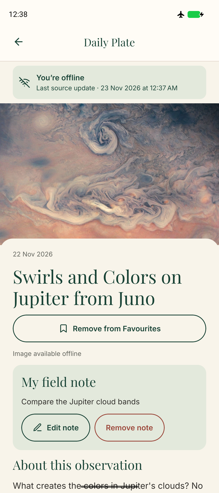
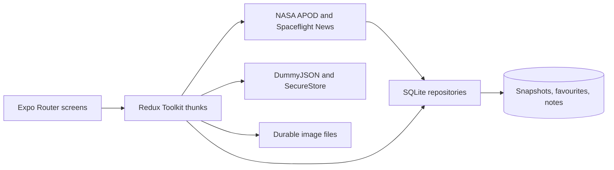

# COSMOLOG

COSMOLOG is an editorial space and science archive for IN3210 Assignment 2. Read NASA Astronomy Picture of the Day and Spaceflight News dispatches, save discoveries to the Field Shelf, and leave private notes for later. A previously verified account can reopen the archive in airplane mode.

**Assignment mapping** · Index 234202J · Space & Science (2) · Offline-first (0)

**Selected bonus** · Reanimated bookmark feedback on a confirmed save, with reduced-motion support

## Run locally

Use the Node version in [`.nvmrc`](.nvmrc), a JDK 21 installation and Android Studio with the SDK/NDK required by the checked-in Android project. For iOS, install a compatible full Xcode and its simulators.

```sh
nvm use
npm ci
npm run android
```

For iOS use `npm run ios`. No API key or `.env` is required. Tap **Use demo account** on the sign-in screen. Registration exercises the DummyJSON simulation and returns to sign-in. The public demo account signs in independently.

### Self-contained Android build

A Gradle release build embeds the JavaScript bundle and assets. For an installable build, supply the local keystore path and its credentials using `COSMOLOG_SIGNING_STORE`, `COSMOLOG_SIGNING_STORE_PASSWORD`, `COSMOLOG_SIGNING_KEY_ALIAS`, and `COSMOLOG_SIGNING_KEY_PASSWORD`. Keep signing secrets outside the repository. With the Android SDK and JDK configured, run:

```sh
cd android
./gradlew :app:assembleRelease
```

Use the existing debug key only for local QA. Avoid Metro when validating airplane-mode cold starts.

## Offline walkthrough

1. Sign in online and wait for the two sources to populate Discover.
2. Open a discovery and save it. Text and provenance are available immediately. For a licensed image, wait for **Image available offline** before relying on the file.
3. Add a note in Details. Open Favourites to find the record by its title, publisher, or note. Use the **With notes** and **Image downloaded** filters.
4. Force-stop the app, turn on airplane mode, then launch it. Open Discover and the saved discovery, including any downloaded image. Edit the note and reopen the record.
5. Restore connectivity. Discover refreshes automatically. Profile shows the last successful timestamp for each source.

A fresh install needs connectivity for the first sign-in. A returning user with a verified SecureStore session can read locally during a network or account service outage. A legacy token-only install needs one verification online. If earlier device bookmarks exist, the Shelf offers a one-time import to the current account.

### Media and provenance

NASA APOD and Spaceflight News retain the original publication link, available credits, and source date. News records contain publisher summaries. APOD video and iframe records link to the source. The app stores images durably when a recognized Creative Commons license or documented NASA-only credit permits it. Other records retain text and provenance. Each saved entry reports its actual image state. The production masthead uses NASA’s Earthrise photograph, AS08-14-2383, credited to NASA / Bill Anders.

- [NASA APOD API](https://api.nasa.gov/assets/files/apod/APOD-APIs-and-RSS-info.pdf)
- [Spaceflight News API v4](https://api.spaceflightnewsapi.net/v4/docs/)
- [DummyJSON authentication](https://dummyjson.com/docs/auth)
- [NASA Earthrise](https://science.nasa.gov/resource/apollo-8s-iconic-earthrise/)
- [Jupiter image credits](https://science.nasa.gov/wp-json/wp/v2/apod-basic/261122) · NASA/Juno/SwRI/MSSS, processing by Matt Brealey and Seán Doran · [CC BY-NC 3.0](https://creativecommons.org/licenses/by-nc/3.0/)

## Screenshots

| Sign in | Discover | Details |
| --- | --- | --- |
|  |  |  |

| Field Shelf | Cold launch offline | Saved image and note |
| --- | --- | --- |
|  |  |  |

## Architecture and state

Expo Router protects the main stack and passes a source and ID to Details. A Redux Toolkit coordinator loads SQLite before starting remote refresh. It shares connection, request, and save state across the screens. Validated and normalized source responses become SQLite transactions. Each transaction updates a source snapshot and its last successful timestamp together.



See [Architecture](design/ARCHITECTURE.md), [Data model](design/DATA_MODEL.md), and [Decision records](docs/DECISIONS.md).

### Key decisions

1. **Restore the verified session locally.** A network profile check made an offline restart look like a logout. SecureStore now holds the verified identity and tokens. Online validation can refresh or revoke them while the archive remains available during a temporary service failure.
2. **Use SQLite and one sync coordinator.** Cached items, source membership, and refresh metadata are durable together. Redux Toolkit thunks were retained so the app has one place that controls request ordering and reconciles results with SQLite. The trade-off is that the coordinator owns deduplication and retry behavior.
3. **Separate bookmarking from downloading.** A file server can be slow or down, so the bookmark is committed first. Image status becomes ready only after the validated local file exists. The journal has useful text and notes even when the image is unavailable.
4. **Own bookmarks and notes by account.** Feed records are public, so the database can reuse them across accounts. The SQLite favourite relationship carries ownership and the field note. A legacy bookmark has no owner until a signed-in person imports it.

## Verification

```sh
npm run lint
npm run typecheck
npm test -- --runInBand
```

Jest exercises auth lifecycle, real SQLite migrations and rollback through Node's SQLite driver, reconnect and source failure behavior, route validation, media normalization, and the journal. A GitHub Actions workflow repeats the JS checks on a clean install. The verified Android run covered cold airplane-mode restore, editing and searching the note offline, automatic reconnect, four screen widths at 1.3× font size, and durable sign-out. See [device scenarios and evidence](docs/TEST_PLAN.md), the [demo script](docs/DEMO_SCRIPT.md), and [AI usage](AI_USAGE.md).
