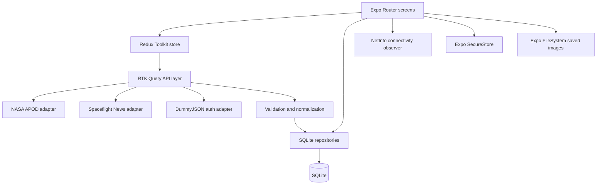

# Architecture proposal

## Responsibilities
- Screens/components: render UI, accessibility, interaction.
- Expo Router: auth flow, tabs, typed details route.
- Redux Toolkit: app/session/request state.
- RTK Query: remote request lifecycle, retries and cache tags.
- API adapters: source-specific transport and mapping.
- Zod: validate untrusted remote/auth payloads and form inputs.
- SQLite repositories: durable cached items, favourites and sync metadata.
- SecureStore: access/refresh token if provided by DummyJSON; no other persistence layer.
- NetInfo: online/offline transition events.
- FileSystem: persist image files explicitly saved for offline use.

## Data loading strategy
1. On app start, initialize/migrate SQLite.
2. Read local feed/favourites and render immediately.
3. Read secure session.
4. If authenticated and online, fetch remote feeds.
5. Validate + normalize.
6. Upsert in a transaction.
7. Update UI from local repository/query invalidation.
8. Record successful sync only after commit.

Do not let RTK Query's in-memory cache be the only offline source.

## No custom backend
No backend is required for the assignment baseline. DummyJSON and public science APIs satisfy the specified external integrations. A custom backend is out of scope unless a concrete requirement emerges.
