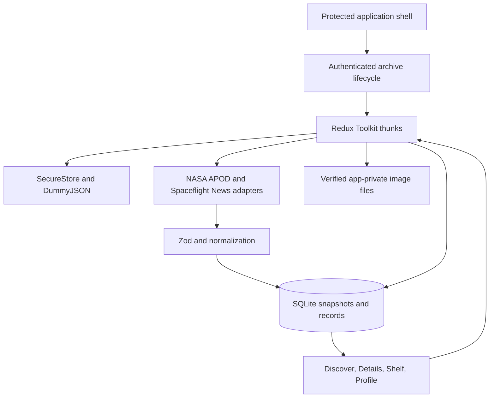

# COSMOLOG architecture

Expo Router protects the main tabs and the direct Details route. A root lifecycle hook starts only for a verified account. It hydrates the local store, observes NetInfo and AppState, and coalesces network events before asking Redux Toolkit to refresh.

- **Session** reads the verified record from SecureStore during boot. Background validation can renew or revoke it. A signed-out marker and conditional writes prevent stale requests restoring a signed-out session.
- **Feed** reads SQLite without waiting for NetInfo. Each source atomically replaces its own membership and timestamp after validation. A failure preserves previous rows and time. The display combines source-specific results.
- **Details** reads by composite key on its own. It requests the direct source endpoint on an online miss. A Details lookup can populate the record cache without inserting the item into a feed snapshot.
- **Shelf** owns bookmarks and notes per DummyJSON user ID. Media availability is derived from checked files, and an interrupted save of an image cannot undo the bookmark.
- **State choice** uses Redux Toolkit thunks for remote and local orchestration. The project chose this permitted option because the coordinator owns the durable reconciliation. See [decision records](../docs/DECISIONS.md).

## Planned cumulative expansion

The [expansion architecture](EXPANSION_ARCHITECTURE.md) and [data contracts](EXPANSION_DATA_CONTRACTS.md) extend this implemented architecture without replacing Redux Toolkit thunks, SQLite, the protected shell, existing pack systems or source adapters. Proposed modules/routes are not yet implemented. See the [roadmap](../PRODUCT_ROADMAP.md) and [release tasks](../tasks/releases/README.md).
