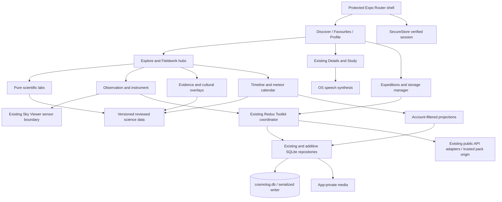

# COSMOLOG expansion architecture — proposed

Applies to F01–F12. This is an incremental target architecture, not a claim that modules exist. Baseline at 971df1033ac3349edbfa95d8debc93700e893646; current [architecture](ARCHITECTURE.md) and ADR-008 remain authoritative for shipped code.

## Design decisions

- Keep Expo Router protected stack, three-source discovery route parser (source + id), Redux Toolkit thunks and serialized SQLite writer. No RTK Query migration or second state store just for the roadmap.
- Prefer a modular monolith on-device: presentation, feature use cases, domain math/validators, local repositories, remote adapters. Inject clocks, file operations, sensors and speech boundaries for tests; no framework ceremony for trivial pure helpers.
- Existing article pack and versioned study pack machinery are distinct; compose them into expedition progress, not competing parallel download pipelines. Use stable public IDs and share media retention. Study installation is currently device-wide, private progress is account-specific. Do not equate installed content with private ownership.
- Offline-only labs and cultural/evidence content use bundled reviewed datasets and, when necessary, the existing versioned content delivery channel. No backend, new cloud database, remote AI inference or embedded secrets. Remote GitHub manifest transport/checksums are not a digital signature; pin trusted origin, validate schema/length/hash/limits, fail closed, don't treat arbitrary remote JSON as executable.
- Keep current native Android packaging, installed Expo SDK 58 and lockfile. Only add SDK-compatible modules per release via expo install; review checked-in native config/permissions and regenerate only intentionally. Preserve platform-specific magazine dock and fallback.
- Session lifecycle owns account transitions; cancel outstanding private tasks on logout, re-check active account at commit, clear account-specific UI before next sign-in. Public archive may remain on device; private rows protected by query filters, not by claiming SQLite encryption or strong multi-user device security. Never log private data or tokens.

## Proposed folders (not scaffolding)

| Existing boundary | Planned addition / extension |
|---|---|
| app/(tabs)/discover.tsx, favourites.tsx, profile.tsx | Add protected entry cards; retain current tabs until navigation review |
| app/reading-packs.tsx, app/study/downloads.tsx | Extend as expedition surfaces; no broken saved URLs |
| app/explore/index.tsx, app/explore/lighttrace.tsx, app/explore/scale.tsx | Planned routes, protected in app/_layout.tsx |
| app/fieldwork/index.tsx, app/fieldwork/observations/[id].tsx, app/fieldwork/instrument.tsx | Planned routes; typed local observation ID; create route separate |
| app/fieldwork/timeline.tsx, app/fieldwork/meteor-calendar.tsx | Planned routes |
| app/study/[id].tsx, app/sky-viewer.tsx | Evidence and culture links/reuse; add dedicated routes only if needed |
| app/offline-library.tsx | Planned management surface |
| src/features/discovery/readingPacks.ts, src/features/study/packDownloads.ts | F01 manifest/step/progress composition |
| src/database/repositories/mediaRepository.ts, src/services/storage/imageStorage.ts | F02 retention/read projection; never bypass ownership |
| src/features/labs/ | F03/F04 pure units, science dataset, presentation |
| src/features/journal/ | F05 observation editor/list, reusable notes/voice |
| src/features/sky/ | F06 sensor projection and F08 layer adapter |
| src/features/study/ | F07 evidence data/reader |
| src/features/timeline/, src/features/events/ | F09/F10 projections and date-aware content |
| src/services/voice/ | F11 synthesis adapter separate from recognition |
| src/theme/ | F12 semantic roles + provider, retain existing default tokens |
| src/database/schema.ts, db.ts, repositories/ | Additive migrations and account-filtered repositories |
| tests/ | Pure math, data schema, UI, migration, lifecycle and regression tests |

Five-tab navigation remains a later UX decision, not a prerequisite. Keep Discover and Favourites visibly accessible for the rubric. Only after hub tasks, device screen-reader/large-font tests and a navigation ADR should Explore and Fieldwork become top-level tabs; maintain existing deep links and dock insets.

## Data flow and lifecycle

**Expedition**: verify account → read manifest/local readiness → explicit download → stage/validate bytes or fetch item through current adapters → commit item + ownership/progress in writer transaction → schedule licensed image work → verify file → render actual availability → retry missing units only. Use cancellation and generation tokens; existing pack installation not lost on partial update. Manifest contents never choose arbitrary URLs/paths.

**Observation**: draft UI → validate → stage optional file with unique opaque relative filename and size/type policy → finalize file → commit owned observation/attachment references → expose durable result. DB/filesystem can't share a true ACID transaction: on commit failure clean the staged file; on crash reconcile orphan files/missing rows at safe maintenance point. Deletion removes relationships transactionally then reconciles only unowned files. No raw external URI retained as permanent file.

**Instrument**: subscribe only while instrument or Sky Viewer active → calibrated/fresh sample → label reference frame and unavailable reasons → optional user-confirmed immutable snapshot → observation. No background sensing or simultaneous watcher leak.

**Science content**: validate bundled/reviewed dataset and source metadata → immutable revision → typed domain functions and read projections → accessibility text equivalent. Public remote data updated only when explicitly supported; not all science modules need API calls.

**Timeline**: account-filtered union/read projection → stable cursor → group by local calendar date → open protected typed route. Missing dates are not replaced with installation time. **Speech**: resolve allowed local text → start single OS narration → handle completion/error/stop → cancel on navigation/account transition; coordinate with recording. **Theme**: load account preference with safe default → semantic tokens → platform UI fallback.

## Security and privacy

Maintain TLS/hostname verification, Zod at untrusted boundaries, bound SQL, finite numeric ranges and route validation. Limit content sizes, concurrent downloads and file path traversal; normalize file names. No location by default in notes; ask per capture, display exactly stored precision and allow removal. No background GPS; no microphone permission for narration. Use least privilege, respect existing Android backup policy, no fabricated cross-device sync. Never publish private photos, voice transcripts, location or demo credentials in Git/screenshots. Local privacy is not equivalent to disk encryption. Source/licensing and science review are release gates. See [contracts](EXPANSION_DATA_CONTRACTS.md) and [release strategy](../docs/RELEASE_STRATEGY.md).
